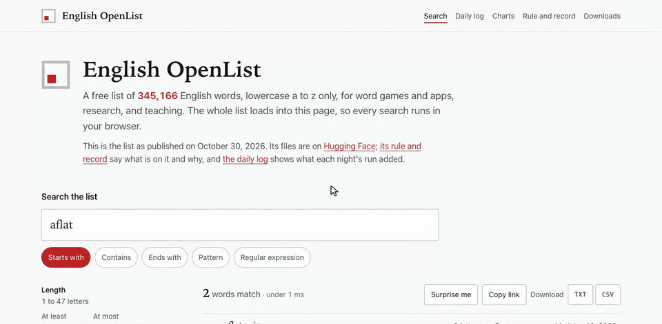

# English OpenList

A free list of English words, lowercase a to z only, published on Hugging Face and kept up by a nightly run that checks new candidates against dictionaries.



*The site: search the whole list in your browser, open any word for its facts and links to look it up, filter by what decided each word, open a night's run on the daily log's chart, and read the charts. `tools/demo_gif.py` records this from the site.*

- **Site:** [english-openlist.pages.dev](https://english-openlist.pages.dev/): search with a panel for every word, the daily log of every nightly run (with an [RSS feed](https://english-openlist.pages.dev/feed.xml)), charts, the rule and record, and downloads.
- **Dataset:** [ryanjosephkamp/english-openlist](https://huggingface.co/datasets/ryanjosephkamp/english-openlist) on Hugging Face.

## Load it

The list is plain text, 1 word a line, sorted.

```bash
curl -sL -o merged_valid_words.txt \
  https://huggingface.co/datasets/ryanjosephkamp/english-openlist/resolve/main/data/merged_valid_words.txt
```

```python
from huggingface_hub import hf_hub_download

path = hf_hub_download(
    "ryanjosephkamp/english-openlist",
    "data/merged_valid_words.txt",
    repo_type="dataset",
)
words = open(path, encoding="utf-8").read().split()
```

The dataset also holds every word's record (`data/merged_valid_dict.json`), the candidates not on the list (`data/merged_invalid_words.txt`), and word-game files by length (`latest/brrrdle/`). The list changes when the nightly run publishes; to pin a version, put a revision of the dataset in place of `main`.

## Its rule

An entry is lowercase a to z and nothing else: `^[a-z]+$`, with no length bound. No capital, space, hyphen, apostrophe, digit, or accent.

So the list is deliberately not a tournament word list: it holds 1-letter words and words longer than 45 letters, which tournament lists exclude. The site's download "Lengths 2 to 45" is the list in that shape.

`merged_invalid_words.txt` is not a list of non-words. It is the pool of candidates, and words move out of it onto the list. No word is invalid for good: a word moved off the list is queued to be checked again.

## How it is kept up

- **The nightly run** (`.github/workflows/daily_update.yml`, at midnight UTC) downloads the lists, looks for new words (Merriam-Webster's and Wordnik's words of the day, and `manual_additions.txt`), checks about 1,000 candidates against Merriam-Webster's Collegiate and Medical dictionaries and the Free Dictionary API, promotes what a dictionary recognizes, and publishes the lists to Hugging Face. It never promotes a single letter other than `a` and `i`: a dictionary's entry for a letter names the letter, so a match says nothing about a word. A lookup that is refused or rate-limited (403 or 429) means the word was not checked that night; it stays a candidate and nothing records it as rejected. A step that fails stops the run. With `skip_upload`, it is a dry run that publishes nothing. Each run writes a post to [`_posts/`](_posts/), and the site's daily log gives every run a page: the words it added, how they got on, and how the list changed.
- **Corrections** move a word only through a ledger in [`corrections/`](corrections/): each row names the word, the action, the reason, the method, the source that ruled, and the date. [`corrections/README.md`](corrections/README.md) explains each one. No other process moves a word.

Each word's record says how it got on the list. The site sorts the records into 4 values (from a source; checked with a model; a model's call alone; generated by rule), explains each where it appears, and charts them.

## Build and test

The pipeline runs on Python 3.12. `requirements.txt` is a lock with hashes, built from `requirements.in`.

```bash
pip install -r requirements.txt
pytest tests/
```

Running the nightly by hand needs `MW_API_KEY` and `HF_TOKEN`, with `MW_MEDICAL_API_KEY` and `WORDNIK_API_KEY` optional (`.env.example`).

The site (`site/`) is Astro with React islands, built from the dataset's files by `tools/eol-build/`. It needs Node 22 or later and pnpm.

```bash
pnpm install
pnpm data:fetch    # the dataset's files, into .cache/hf/
pnpm data:build    # the browser's files, the charts' figures, and the daily log
pnpm test
pnpm build         # site/dist/, then the checks in site/scripts/check-dist.mjs
```

A build is a review preview, with a banner and `noindex`, unless `EOL_PRODUCTION=1`.

The Tests workflow (`.github/workflows/tests.yml`) runs on every pull request: `pytest`, then `pnpm test` and the type checks of the build tool and the site.

To record the demo above again (it needs Chrome and ffmpeg):

```bash
uv run --no-project --isolated --with playwright==1.58.0 python tools/demo_gif.py
```

## Repository

| Path | Holds |
|---|---|
| `scripts/` | the nightly's steps: download, discovery, validation, the word-game files, the upload, and the daily statistics |
| `corrections/` | the ledgers of every word moved by hand |
| `tests/` | the pipeline's tests |
| `.github/workflows/` | the nightly run, the tests, and the site's deploy |
| `site/`, `tools/eol-build/`, `packages/wordlist/` | the site, the build of its data and the daily log, and the word list's binary format and search |
| `tools/demo_gif.py` | the recording of the demo above |
| `archive/`, `updates/` | the daily statistics kept over time |

## License

Code: MIT, in [`LICENSE`](LICENSE). Data: see the dataset's [card on Hugging Face](https://huggingface.co/datasets/ryanjosephkamp/english-openlist).

## Contact

Questions, corrections, and requests: [open an issue](https://github.com/ryanjosephkamp/english-openlist/issues) or write to ryanjosephkamp@gmail.com.
